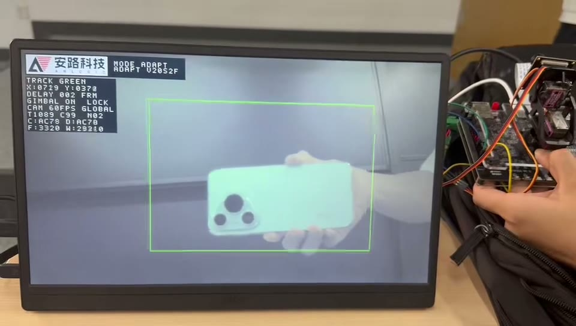

# Huiyan FPGA Gimbal

**An FPGA vision servo that turns a camera toward a selected color target.**

Huiyan pairs an Anlogic HX1P35A board with an SC500 MIPI camera, two servos, and an HDMI display. The demo shows target learning, pan and tilt control, and on-screen tracking and frame-age data.

[简体中文](README.md) · [Reproduction guide (Chinese)](docs/reproduce.md) · [Evidence (Chinese)](docs/evidence.md) · [Full demo and technical report](https://github.com/e-contest-FPGA/huiyan-fpga-gimbal/releases/tag/v1.0.0)



- **V20S2F** is the firmware label visible in the competition recording.
- **V20S2F2** is the hardware baseline with an archived bitstream hash, a recorded Flash write, and a power-cycle display check.
- **V21F1** analyzes targets before the DDR frame buffer and uses frame IDs to pair historical boxes with displayed video. The archive contains simulation and routed build results. A board run for this build is pending.

The design uses color and spatial cues, so visually similar objects can be ambiguous. The on-screen frame age is an internal capture-to-render metric in frame periods.

With Python 3 and Icarus Verilog on your PATH, run:

```sh
python tools/simulate.py
```

The tests exercise target acquisition on pale backgrounds, motion control, frame age, exposure, telemetry, and clock-domain mailboxes. A board build also needs the matching team archive and vendor dependencies. See the [reproduction guide](docs/reproduce.md) and [source notice](NOTICE.md).
