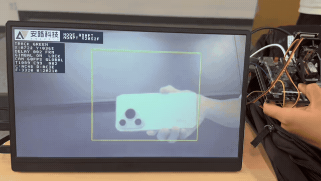
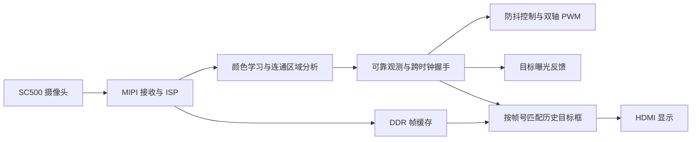

# 慧眼随行 · Huiyan FPGA Gimbal

**用一块国产 FPGA，让摄像头跟着指定颜色目标转动。**

在安路 HX1P35A 上实现 720p 视频采集、目标学习、双轴 PWM 跟随和 HDMI 画面叠加。屏幕同时显示目标框、坐标、摄像头帧率与帧龄，便于直接观察识别结果如何变成云台动作。

[English](README.en.md) · [无板仿真](docs/reproduce.md#独立仿真) · [硬件接线](docs/hardware.md) · [测试证据](docs/evidence.md) · [完整演示与技术报告](https://github.com/e-contest-FPGA/huiyan-fpga-gimbal/releases/tag/v1.0.0)

[](https://github.com/e-contest-FPGA/huiyan-fpga-gimbal/actions/workflows/simulation.yml) [MIT 许可证（团队原创代码）](LICENSE)



*实拍摘自完整演示 02:22 处。屏幕固件标识为 ADAPT V20S2F。* [下载 12 秒精简片段](https://github.com/e-contest-FPGA/huiyan-fpga-gimbal/releases/download/v1.1.0/huiyan-tracking-12s.mp4)

## 功能

- **选中目标，让云台跟随。** 手动模式从中央取景区学习颜色。自动模式由静止摄像头下的运动区域触发学习。两轴根据目标偏离画面中心的幅度修正。
- **比较七种显示模式。** 原图、灰度、二值、边缘、自适应增强、卡通和同帧分屏。目标测光可独立切换。
- **观察视频帧龄。** 实拍中的 `002 FRM` 对应两个采集帧周期，显示的是内部视频链路的帧龄。
- **研究更早的反馈链路。** V21F1 在视频写入 DDR 前分析目标。控制侧使用最新可靠观测，显示侧按帧号匹配历史目标框。

## 不用开发板也能跑

安装 Python 3.9+ 和 Icarus Verilog，将 `iverilog` 与 `vvp` 加入 PATH。

```sh
git clone https://github.com/e-contest-FPGA/huiyan-fpga-gimbal.git
cd huiyan-fpga-gimbal
python tools/simulate.py --test servo_system
```

集成台架用合成画面检查目标确认、显示缓存晚于控制、坏帧、曝光和遮挡保持。默认命令 `python tools/simulate.py` 共运行 9 组 HDL 检查。

| 想做什么 | 入口 |
| --- | --- |
| 看目标锁定和云台动作 | [完整视频约 02:12 起](https://github.com/e-contest-FPGA/huiyan-fpga-gimbal/releases/tag/v1.0.0) |
| 查硬件、构建和拨码开关 | [接线与上板](docs/hardware.md) · [工程恢复](docs/reproduce.md#完整板级工程) |
| 查跟踪、曝光与跨时钟模块 | [V21F1 RTL](rtl/v21f1) · [模块索引](docs/rtl-guide.md) |
| 报告问题或提交实测 | [贡献说明](CONTRIBUTING.md) · [路线与验证状态](docs/roadmap.md) |

## V21F1 数据流



| 版本 | 在本项目中的位置 | 对应证据 |
| --- | --- | --- |
| **V20S2F** | 视频里的演示版本 | 实拍画面、手动锁定、跟随和帧龄显示 |
| **V20S2F2** | 上板基线 | 固件哈希、Flash 写入、断电启动和约 2 帧读数 |
| **V21F1** | 较新的分析与控制工程 | 完成综合布线与回归，整机效果待实测 |

参赛技术报告记录了不同阶段的设计和指标。固件、性能和测量口径见 [版本与测试证据](docs/evidence.md)。项目适用于带颜色标记的自动跟拍、桌面视觉控制和嵌入式教学。

本仓库提供团队 RTL、可运行台架、串口工具和工程复现说明。完整 TD 工程所需的厂商例程、加密 IP 和 bitstream 有独立来源。详见 [源码来源与授权范围](NOTICE.md)。
