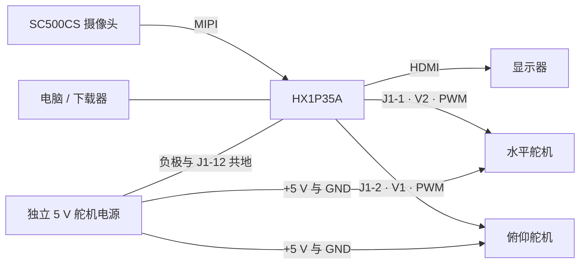

# HX1P35A 接线和第一次上板

[软件与工程入口](reproduce.md) · [English quick start](quickstart.en.md) · [实机验收](hardware-validation.md)

适用板卡为 HX1P35A（PH1P35MDG324），摄像头为 SC500CS。已有断电启动记录的固件是 **V20S2F2**。最早的实拍视频标识为 V20S2F。

## 所需硬件

| 部件 | 要求 |
| --- | --- |
| FPGA 开发板 | HX1P35A / PH1P35MDG324，使用配套的开发板供电和 USB 下载线 |
| 摄像头 | SC500CS，配该板的 MIPI 排线 |
| 视频输出 | HDMI 显示器与线缆 |
| 云台 | 两轴支架和两个支持标准 PWM 的舵机。舵机供电及 3.3 V 控制输入兼容性按实际型号核对 |
| 舵机供电 | 独立 5 V 电源与分线。原型使用标称 5 V / 3 A 适配器，实际容量按两只舵机负载选择 |

## 连接

| 信号 | 板上连接器 | FPGA 引脚 / 电平 |
| --- | --- | --- |
| 水平 PWM | **J1 第 1 脚** | V2 / 3.3 V |
| 俯仰 PWM | **J1 第 2 脚** | V1 / 3.3 V |
| 共地 | **J1 第 12 脚** | GND |

断电连接排线和舵机。用板上的 J1 第 1 脚标记确认方向。外部舵机电源的正极只连接舵机电源分支，负极接到 J1 地。摄像头排线留出双轴动作余量，首次测试把目标放在中位附近。

## 上电顺序

1. 保持 SW3 下拨，先验证 FPGA 板和 HDMI 画面。用下载工具以 SRAM 模式选择对应固件，见[板级工程恢复](reproduce.md#完整板级工程)。
2. 按 K3 或 K4 切换画面模式。将颜色目标对准画面中央，再拨上 SW2。观察屏幕能否画出目标框。
3. 确认支架和排线可活动后，再拨上 SW3。分别小幅移动目标，核对水平及俯仰方向。发现追反、撞限位或卡滞时，立即下拨 SW3，必要时切断舵机电源。
4. SW1 可启用自动发现，SW4 可请求目标优先测光。比较版本前固定相机设置、舵机安装位置和拨码状态。

本图按比赛板的 J1 连接和归档约束整理。板卡修订、工具和配套例程请以[安路赛题资料](https://www.anlogic.com/support/university/competitions/eda/news1/42.html)为准。
